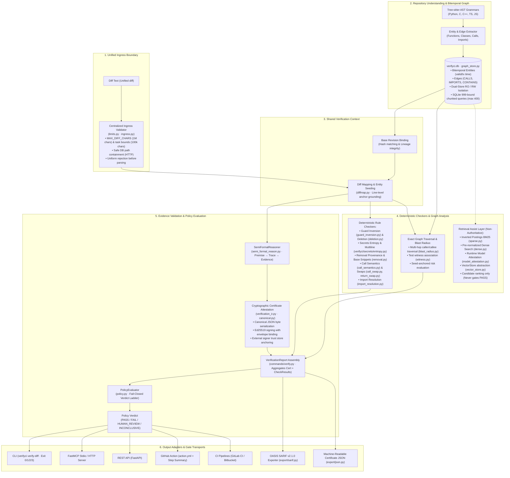

# VerifyCI System Architecture

VerifyCI is a local-first, verification-first code intelligence platform. It replaces probabilistic heuristics with deterministic mathematical verification: repository code is indexed into a bitemporal Code Property Graph (CPG), proposed diffs are grounded onto that graph, deterministic invariant and blast-radius checks execute, and an authoritative, cryptographically signed Certificate is evaluated by a fail-closed PolicyEvaluator.

---

## Authoritative Verification Pipeline Flow

The verification engine executes in 6 strictly ordered stages:

---

## Architectural Subsystems

### 1. Ingress Validation & Boundary Hardening (`verifyci/interface/ingress.py`, `limits.py`)
To prevent cap-bypasses or disparate enforcement across transports, all request inputs pass through a centralized ingress boundary before reaching AST parsing, diff tokenization, or database operations:
- **`validate_diff_ingress`**: Enforces strict payload bounds on standalone verification diffs (`MAX_DIFF_CHARS = 1,000,000` characters, defined in `limits.py`).
- **`validate_task_ingress`**: Enforces task instruction length caps and bounds accompanying diffs to `MAX_TASK_DIFF_CHARS = 100,000` characters.
- **`validate_query_ingress`**: Enforces retrieval query length (`MAX_QUERY_CHARS = 10,000`) and result limits (`MAX_K = 1,000`).
- **`validate_safe_db_path`**: Enforces strict containment of `.db` storage paths within the repository's `.verifyci` directory, preventing path traversal (`..`), null-byte injection, and arbitrary filesystem access across the HTTP network surface (`http.py`). (CLI surfaces resolve explicit `--db` flags via `resolve_db`).
- **`validate_safe_path`**: Security utility for directory containment, path traversal prevention, and file extension validation.
- **Universal Transport Boundary**: CLI (`cli.py`, `commands/verify.py`), MCP (`mcp_server.py`), FastMCP (`fastmcp_server.py`), and HTTP (`http.py`) all route through these identical ingress validation primitives before parsing, retrieval, or orchestration. In the CLI, inputs exceeding `MAX_DIFF_CHARS` at the boundary trigger an infrastructure refusal exit code (`3`, `INFRA_ERROR`).

### 2. Frozen Contracts & Certificate Cryptographic Attestation (`verifyci/contracts/`)
The foundation of VerifyCI consists of immutable, frozen dataclass schemas that define the boundary across all modules:
- **`Entity` (`entity.py`)**: Code entities (functions, methods, classes, modules) with bitemporal intervals (`valid_from`/`valid_until`, `t_created`/`t_expired`), location spans, and source hashes.
- **`Edge` (`edge.py`)**: Semantic relationships between entities (`CALLS`, `IMPORTS`, `CONTAINS`, `DEPENDS_ON`).
- **`Revision` (`revision.py`)**: Manifest of files and content hashes identifying a code state.
- **`Certificate` (`verification_ir.py`)**: The authoritative verification record containing premises, file evidence snippets, execution traces, cryptographic waivers, and verification status.
- **Canonical Certificate Hashing (`canonical.py`)**: Computes deterministic UTF-8 byte serialization (`canonical_certificate_bytes`) and SHA-256 content hashes (`certificate_hash`) using key-sorted, separator-normalized JSON (`allow_nan=False`). In `CERTIFICATE_EXCLUDED_FIELDS`, only `{"signature"}` is excluded, ensuring `signing_key_id` and `signature_algorithm` remain cryptographically bound into the signed payload.
- **Asymmetric Ed25519 Certificate Signing (`verification_ir.py`)**:
  - `Certificate.sign(private_key, key_id)`: Signs canonical envelope bytes using Ed25519 (supporting raw 32-byte `bytes`/`bytearray`, 64-char hex strings, or `Ed25519PrivateKey`). Derives public key identity if `key_id` is omitted and sets `signature_algorithm="ed25519"`.
  - `Certificate.verify_signature(public_key, trusted_keys)`: Verifies authenticity fail-closed:
    1. If an explicit `public_key` is passed, validates the signature and asserts `signing_key_id` consistency.
    2. When no explicit key is provided, the signer **must be resolved through an externally configured trust store** (via `trusted_keys` parameter or environment variable `VERIFYCI_CERTIFICATE_PUBLIC_KEYS` / `ACI_CERTIFICATE_PUBLIC_KEYS`). An embedded key in `signing_key_id` cannot self-certify without trust store endorsement.
    3. Mandatory protocol validation: rejects missing, empty, non-string, or non-`"ed25519"` algorithm metadata.
    4. Serialization protection: catches non-finite numeric floats (`NaN`, `Infinity` rejected by `allow_nan=False`) and returns `False` fail-closed without exception leakage.
- **`SignedIntentWaiver` (`verification_ir.py`)**: Cryptographic waivers (`hmac-sha256` and `ed25519`) over canonical `"{waiver_id}:{target}:{signer}:{reason}"` payloads, allowing explicit, signed human-in-the-loop exemptions for intentional policy violations (denying unauthenticated waivers by default).
- **`VerificationReport` & `CheckResult` (`verification_ir.py`)**: Individual deterministic check outcomes, score, blocking flags, and grounding establishment.
- **`VerificationDecision` & `VerificationPolicy` (`verification_ir.py`)**: Fail-closed policy evaluation decisions.
- **`jsonio` (`jsonio.py`)**: Canonical JSON serialization converting dataclasses and `Enum.value` without schema drift.

### 3. Ingestion & AST Extraction (`verifyci/ingestion/`)
- Uses native **Tree-sitter** grammars for high-throughput, incremental parsing (Python, C, C++, TypeScript, JavaScript).
- Extracts code entities, spans, decorators, and call/import references.
- Classifies files using `FilePartition` (`CODE_CORE`, `DOCUMENTATION`, `CONFIGURATION`, `TEST_SUITE`, `ANCILLARY`).
- Employs deep recursion limits and falls back to coarse `MODULE`-level entities on pathological inputs without crashing.

### 4. Graph Storage & Concurrency Isolation (`verifyci/storage/graph_store.py`)
- Persistent SQLite database running in **Write-Ahead Logging (WAL)** mode for concurrent readers and atomic writers (`PRAGMA journal_mode=WAL`).
- **Dual-Store Boundary**:
  - Observation tools use read-only store instances (`ro_store` via `_format_ro_uri` SQLite `mode=ro` cache) preventing write locks, schema modifications, or journal flips.
  - Task executions use read-write store instances (`rw_store`) for ledger updates.
  - Dual-store instances are orchestrated at the agent/interface layer (`fastmcp_server.py`, `mcp_server.py`).
- **Bitemporal Semantics**:
  - *Valid time* (`valid_from` / `valid_until`): when the code was valid in the repository revision. Point-in-time entity resolution queries `valid_from <= ? AND (valid_until IS NULL OR valid_until > ?)`.
  - *Transaction time* (`t_created` / `t_expired`): when the record was ingested into the database. Live records query `t_expired IS NULL`.
- **Chunked Query Bounds**: Bounded SQL parameters (`_SQLITE_PARAM_CHUNK = 400`) enforce strict compliance under the SQLite 999 parameter ceiling (`SQLITE_MAX_VARIABLE_NUMBER`).

### 5. Verification Engine (`verifyci/verification/`)
- **Diff Mapping & Anchor Grounding (`diffmap.py`)**: Maps unified diff lines to base code entities. Enforces the invariant that **every changed line must land inside a recognized entity span**. Stray edits outside spans fail grounding establishment (`established=False`), routing to `INCONCLUSIVE`.
- **Semi-Formal Reasoner (`semi_formal_reason.py`)**: Constructs formal premises from diff hunks, traces call paths through the CPG, collects file evidence snippets, evaluates internal verification checks, optionally signs the resulting certificate with a configured Ed25519 key, and outputs an authoritative `Certificate`.
- **Deterministic Rule Checkers**:
  - *Guard Inversion (`guard_inversion.py`)*: Detects inverted conditionals, auth checks, and boundary guards.
  - *Guard & Code Deletions (`deletion.py`)*: Checks Class 3 guard and critical validation deletions requiring waivers.
  - *Call Semantics (`call_semantics.py`)*: Validates argument bindings, call conventions, and parameter order.
  - *Call & Return Swaps (`call_swap.py`, `return_swap.py`)*: Detects swapped call targets and inverted return statements.
  - *Import Resolution (`import_resolution.py`)*: Validates import accessibility and module bindings.
  - *Removal Provenance (`removal.py`)*: Cross-references deleted `-` lines against stored base-revision snippets to catch stale or fabricated deletions.
  - *Secret Detection (`verifyci/secrets/entropy.py`, `engine.py`, `intent_align.py`)*: Scans additions with multi-rule entropy, multiline tracking, and regex rules.
- **Exact Graph Traversal & Blast Radius (`blast_radius.py`, `witness.py`)**: Traverses call-graph paths to evaluate impacted callers, callees, and test coverage gaps.
- **Policy Evaluator (`policy.py`)**: Evaluates `VerificationReport` under strict fail-closed rules:
  - Rejection on any blocking check yields `FAIL`.
  - Checks that did not establish grounding or ran without established status route to `INCONCLUSIVE` (never a false `PASS`).
  - Non-blocking failure escalates to `HUMAN_REVIEW`.
  - `PASS` is awarded only when all checks pass and are strictly established.

### 6. Retrieval, Scalability & Model Attestation (`verifyci/retrieval/`)
- **VectorStore Abstraction (`verifyci/contracts/vector_store.py`)**: Standard interface (`upsert`, `search`) decoupled from retriever logic, supporting in-memory (`InMemoryVectorStore`) and persistent implementations.
- **Sparse BM25 Inverted Postings Index (`sparse.py`)**: `BM25Retriever` maintains an inverted postings index (`_postings: dict[str, list[tuple[str, int]]]`) to evaluate only documents sharing at least one query term, pruning the candidate space while preserving exact BM25 scores and deterministic tie-breaking (`sort(key=lambda r: (-r.score, r.id))`).
- **Dense Unit-Normalized Dot Product (`dense.py`)**: `DenseRetriever` unit-normalizes document vectors during `build_index()`, simplifying cosine similarity calculations during search to an efficient dot product with deterministic tie-breaking.
- **Runtime Model Attestation (`model_attestation.py`)**:
  - Resolves local HuggingFace/cross-encoder snapshot directories strictly offline (`local_files_only=True`), eliminating external network failure modes.
  - `compute_snapshot_manifest()` recursively traverses all files affecting model loading (`snap_path.rglob("*")`), sorting by normalized relative POSIX paths (`.relative_to().as_posix()`) to maintain cross-platform consistency across Windows and Linux.
  - Structurally unambiguous hashing: builds a canonical manifest list where every entry records `path`, `sha256`, and `size_bytes`. Serializes the manifest deterministically (canonical JSON) and hashes the serialization, preventing record-boundary collisions.
  - Enforced reranker gating (`reranker.py`): When `enforce_attestation=True`, `CrossEncoderReranker` requires a trusted `expected_snapshot_sha256` pin (and optional commit pin). If attestation fails or pins mismatch, it refuses to load unverified model weights and falls back fail-closed to `OfflineReranker`.
- **Non-Authoritative Role**: Retrieval assists candidate entity discovery; **correctness is exclusively established by exact graph traversal and deterministic policy checkers**.

### 7. Evidence Provenance & Bundle Generation (`scripts/build_evidence_bundle.py`, `claims.py`)
- **Forensic Execution Metadata**: Records commit SHA (`git rev-parse HEAD`), dirty worktree status (`clean_worktree` via porcelain status), Python version, lockfile SHA-256 (`uv.lock`), and resolved package distribution versions.
- **Fail-Closed Evidence Predicates & Provenance Gate**: Evaluates raw benchmark outputs independently under strict fail-closed rules:
  - *Mandatory Provenance Metadata*: Every evaluated claim requires the complete set of frozen protocol and corpus hashes (`REQUIRED_FROZEN_FIELDS`); omitted or malformed metadata immediately fails provenance. Full 64-character SHA-256 digests are required (no truncated prefixes accepted).
  - *Mandatory Implementation Source Manifest*: The retrieval implementation source set (`vector_store.py`, `dense.py`, `sparse.py`, `fusion.py`) is enforced as mandatory (`MANDATORY_RETRIEVAL_SOURCES`); missing manifest entries, unexpected entries, altered pinned hashes (`PINNED_RETRIEVAL_SOURCE_HASHES`), or modified manifest artifacts (`TRUSTED_RETRIEVAL_MANIFEST_HASH`) fail provenance immediately.
  - *Strict File & Hash Integrity*: Missing benchmark data files or measured-source implementations fail provenance; differences in corpus, protocol, or source hashes downgrade claims to `PROVENANCE_MISMATCH`. Line endings are normalized (`\r\n` to `\n`) during verification to maintain cross-platform integrity.
  - *Model Snapshot Provenance (H1-RR)*: Benchmark artifacts (`benchmarks/beir/rerank_revision/results.json`) record the model's snapshot commit, canonical composite `model_snapshot_sha256`, per-file hashes (`model_files`), and the complete 6-entry `model_manifest` (with relative paths, SHA-256 digests, and byte sizes) for auditability and exact reproduction.
  - *Set-Theoretic Measurement Recomputation*: Where per-case records and ground truth are available, aggregate metrics are derived dynamically from underlying sets:
    - `patch_corpus`: Recomputes agreement, deterministic catch rate, and semantic false-accept rate from case-level verdicts against ground-truth categories.
    - `blast_radius_bounds`: Derives case recall directly from underlying entity sets (\(\operatorname{Recall} = \frac{|\operatorname{Expected}\cap\operatorname{Detected}|}{|\operatorname{Expected}|}\)) for non-empty expected cases, rejecting malformed records and ignoring stored recall fields.
  - *Cryptographic Result Binding*: Benchmark result artifacts are cryptographically bound to canonical SHA-256 hashes (`TRUSTED_RESULT_HASHES`), ensuring result data cannot be modified in place.
  - *Fail-Closed Worktree State*: An unknown working-tree state (`clean_worktree is None`) never silently passes; it sets `provenance_verified = False`, forces `overall_status` to `UNESTABLISHED`, and downgrades every otherwise-established claim to `PROVENANCE_MISMATCH` with `provenance_error="unknown_worktree"`. Uncommitted tree drift (`clean_worktree is False`) downgrades established claims to `PROVENANCE_MISMATCH` with `provenance_error="dirty_worktree"` unless an explicit override is recorded (`dirty_override_recorded: True`).

### 8. Network & Multi-Platform Integration Surface
- **CLI (`verifyci.interface.cli`)**: Terminal command interface with standardized exit codes:
  - `0`: `PASS` (Established grounding, zero blocking check failures).
  - `1`: `FAIL` (Blocking check or invariant tripped).
  - `2`: `HUMAN_REVIEW` / `INCONCLUSIVE` (Ungrounded diff, policy edit, escalated).
  - `3`: `INFRA_ERROR` / `TIMEOUT` / `REFUSAL` (DB missing/corrupt, task deadline exceeded, or oversized diff input exceeding `MAX_DIFF_CHARS` rejected at ingress).
- **Exporters (`verifyci.export/`)**:
  - `export_certificate_json` (`json.py`): Stable machine-readable Certificate, Report, Decision, and Policy serialization under schema `https://verifyci.org/schemas/v1/certificate-report.json`.
  - `export_sarif` (`sarif.py`): OASIS SARIF v2.1.0 output for GitHub Code Scanning and IDE security panels.
- **Composite GitHub Action (`action.yml`)**: Local-first composite action verifying PR changes without SaaS dependencies, reporting structured results via `$GITHUB_STEP_SUMMARY`.
- **Multi-CI Pipelines (`docs/integrations/ci_pipelines.md`)**: Reference pipeline definitions for GitLab CI, Bitbucket Pipelines, and pre-commit hooks.
- **Model Context Protocol (`verifyci.interface.fastmcp_server`, `mcp_server.py`)**: FastMCP stdio/HTTP server allowing AI agents to query the graph and verify diffs interactively with diff size caps and loopback protection.
- **REST API (`verifyci.interface.http`)**: FastAPI HTTP server with loopback-default protection and safe database path containment.
