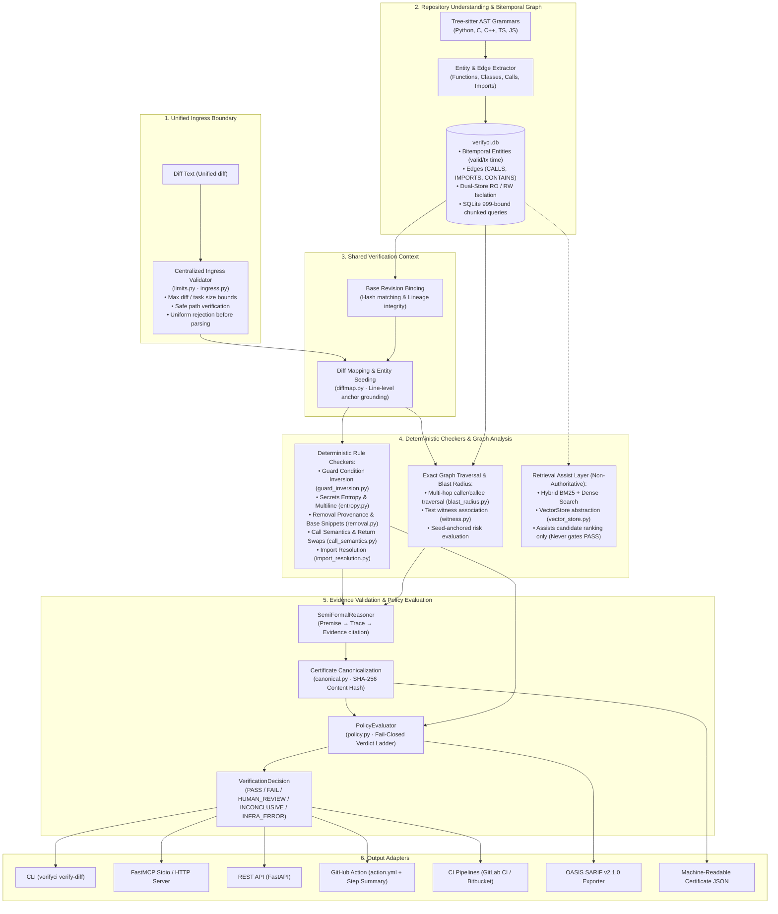

# VerifyCI System Architecture

VerifyCI is a local-first, verification-first code intelligence platform. It replaces probabilistic heuristics with deterministic mathematical verification: repository code is indexed into a bitemporal Code Property Graph (CPG), proposed diffs are grounded onto that graph, deterministic invariant and blast-radius checks execute, and an authoritative Certificate is evaluated by a fail-closed PolicyEvaluator.

---

## Authoritative Verification Pipeline Flow

The verification engine executes in 6 strictly ordered stages:

---

## Architectural Subsystems

### 1. Ingress Validation & Boundary Hardening (`verifyci/interface/ingress.py`)
To prevent cap-bypasses or disparate enforcement across transports, all request inputs pass through a centralized ingress boundary before reaching AST parsing, diff tokenization, or database operations:
- **`validate_diff_ingress`**: Enforces strict payload bounds (`MAX_DIFF_CHARS = 1,000,000`).
- **`validate_task_ingress`**: Enforces task length caps (`MAX_TASK_DIFF_CHARS = 100,000`) and validates accompanying diffs.
- **`validate_query_ingress`**: Enforces retrieval query length (`MAX_QUERY_CHARS = 10,000`) and result limits (`MAX_K = 1,000`).
- **`validate_safe_db_path`**: Enforces strict containment of `.db` storage paths within the repository's `.verifyci` directory, preventing path traversal (`..`), null-byte injection, and arbitrary filesystem access across HTTP and CLI surfaces.
- **`validate_safe_path`**: General safe path validator checking directory containment, traversal attempts, and allowed file extensions.
- **Universal Transport Boundary**: CLI, MCP (`mcp_server.py`), FastMCP (`fastmcp_server.py`), and HTTP (`http.py`) all route through these identical ingress validation primitives before parsing, retrieval, or orchestration.

### 2. Frozen Contracts & Certificate Integrity (`verifyci/contracts/`)
The foundation of VerifyCI consists of immutable, frozen dataclass schemas that define the boundary across all modules:
- **`Entity`**: Code entities (functions, methods, classes, modules) with bitemporal intervals (`valid_from`/`valid_until`, `t_created`/`t_expired`), location spans, and source hashes.
- **`Edge`**: Semantic relationships between entities (`CALLS`, `IMPORTS`, `CONTAINS`, `DEPENDS_ON`).
- **`Revision`**: Manifest of files and content hashes identifying a code state.
- **`Certificate`**: The authoritative verification record containing premises, file evidence snippets, execution traces, cryptographic waivers, and verification status.
- **Canonical Certificate Hash (`canonical.py`)**: Computes deterministic SHA-256 content hashes (`canonical_certificate_bytes`, `certificate_hash`) over normalized, key-sorted JSON representations. This provides tamper-evident integrity verification and independent auditability across processes, storage boundaries, and serialization formats.
- **Integrity vs. Cryptographic Authenticity**: Canonical hashing establishes that certificate content has not been altered or corrupted in transit. Content hashing alone does not establish cryptographic authorship or multi-party non-repudiation. For authorization policies requiring cryptographic attestation, VerifyCI implements cryptographic signatures (HMAC-SHA256 and Ed25519) on waiver contracts (`SignedIntentWaiver`). If cross-machine or cross-tenant certificate attestation is required, certificates can be paired with an external cryptographic signing envelope.
- **`VerificationReport` & `CheckResult`**: Individual deterministic check outcomes, score, blocking flags, and grounding establishment.
- **`VerificationDecision` & `VerificationPolicy`**: Fail-closed policy evaluation decisions.
- **`jsonio`**: Canonical JSON serialization handling enums and nested dataclasses without schema drift.

### 3. Ingestion & AST Extraction (`verifyci/ingestion/`)
- Uses native **Tree-sitter** grammars for high-throughput, incremental parsing (Python, C, C++, TypeScript, JavaScript).
- Extracts code entities, spans, decorators, and call/import references.
- Classifies files using `FilePartition` (`CODE_CORE`, `DOCUMENTATION`, `CONFIGURATION`, `TEST_SUITE`, `ANCILLARY`).
- Employs deep recursion limits and falls back to coarse `MODULE`-level entities on pathological inputs without crashing.

### 4. Graph Storage & Concurrency Isolation (`verifyci/storage/`)
- Persistent SQLite database running in **Write-Ahead Logging (WAL)** mode for concurrent readers and atomic writers.
- **Dual-Store Boundary**:
  - Observation tools run on read-only store instances (`ro_store`) preventing write locks or journal flips.
  - Task executions use read-write store instances (`rw_store`) for ledger updates.
- **Bitemporal Semantics**:
  - *Valid time*: when the code was valid in the repository revision.
  - *Transaction time*: when the record was ingested into the database.
- **Chunked Query Bounds**: Bounded SQL parameters (max chunk 400) enforce strict compliance under the SQLite 999 parameter ceiling.

### 5. Verification Engine (`verifyci/verification/`)
- **`DiffMap`**: Maps unified diff lines to base code entities. Enforces the invariant that **every changed line must land inside a recognized entity span**. Stray edits outside spans force `INCONCLUSIVE`.
- **`SemiFormalReasoner`**: Constructs formal premises from diff hunks, traces call paths through the CPG, and outputs a canonical `Certificate`.
- **`BlastRadius`**: Traverses call-graph paths to evaluate impacted callers, callees, and test coverage gaps.
- **`RemovalProvenance`**: Cross-references deleted `-` lines against stored base-revision snippets to catch stale or fabricated deletions.
- **`GuardCondition`**: Checks that defensive validation logic, bounds checks, or auth assertions are not inverted or deleted.
- **`SecretsScan`**: Scans added lines with multi-rule entropy, multiline continuation tracking, and regex patterns.
- **`PolicyEvaluator`**: Evaluates checks under strict fail-closed rules. Checks that did not establish grounding route to `INCONCLUSIVE`, never a false `PASS`.

### 6. Retrieval & Vector Store Boundary (`verifyci/retrieval/`)
- **VectorStore Abstraction (`verifyci/contracts/vector_store.py`)**: Standard interface (`upsert`, `search`) decoupled from retriever logic, supporting in-memory and persistent implementations.
- **Sparse BM25 (`sparse.py`)**: Add-time precomputed term frequencies and exact document frequencies.
- **Non-Authoritative Role**: Retrieval prioritizes code candidate entities for agent review; **correctness is exclusively established by exact graph traversal and deterministic policy checkers**.

### 7. Evidence Provenance & Bundle Generation (`scripts/build_evidence_bundle.py`, `claims.py`)
- **Forensic Execution Metadata**: Records commit SHA, dirty worktree status (`clean_worktree`), Python version, lockfile SHA-256 (`uv.lock`), and resolved package versions.
- **Fail-Closed Evidence Predicates & Provenance Enforcement**: Evaluates raw benchmark outputs independently. Uncommitted working tree drift (`clean_worktree is False`), protocol hash mismatches (`config_sha256`), corpus hash mismatches (`corpus_sha256`, `qrels_sha256`, `cases_sha256`), or measured-source identity drift (`frozen_sources`) automatically invalidate claim establishment, downgrading claims to `PROVENANCE_MISMATCH` and forcing `overall_status` to `UNESTABLISHED` (unless an explicit override like `allow_dirty=True` is provided).

### 8. Network & Multi-Platform Integration Surface
- **CLI (`verifyci.interface.cli`)**: Terminal command interface with standardized exit codes:
  - `0`: `PASS` (Established grounding, zero blocking check failures).
  - `1`: `FAIL` (Blocking check or invariant tripped).
  - `2`: `HUMAN_REVIEW` / `INCONCLUSIVE` (Ungrounded diff, policy edit, escalated).
  - `3`: `INFRA_ERROR` / `TIMEOUT` (DB missing/corrupt or task deadline exceeded).
- **Exporters (`verifyci.export`)**:
  - `export_certificate_json`: Stable machine-readable Certificate and Report serialization.
  - `export_sarif`: OASIS SARIF v2.1.0 output for GitHub Code Scanning.
- **Composite GitHub Action (`action.yml`)**: Local-first composite action verifying PR changes without SaaS dependencies, reporting structured results via `$GITHUB_STEP_SUMMARY`.
- **Multi-CI Pipelines (`docs/integrations/ci_pipelines.md`)**: Reference pipeline definitions for GitLab CI, Bitbucket Pipelines, and pre-commit hooks.
- **Model Context Protocol (`verifyci.interface.fastmcp_server`)**: FastMCP stdio/HTTP server allowing AI agents to query the graph and verify diffs interactively with diff size caps and loopback protection.
- **REST API (`verifyci.interface.http`)**: FastAPI HTTP server with loopback-default protection.
