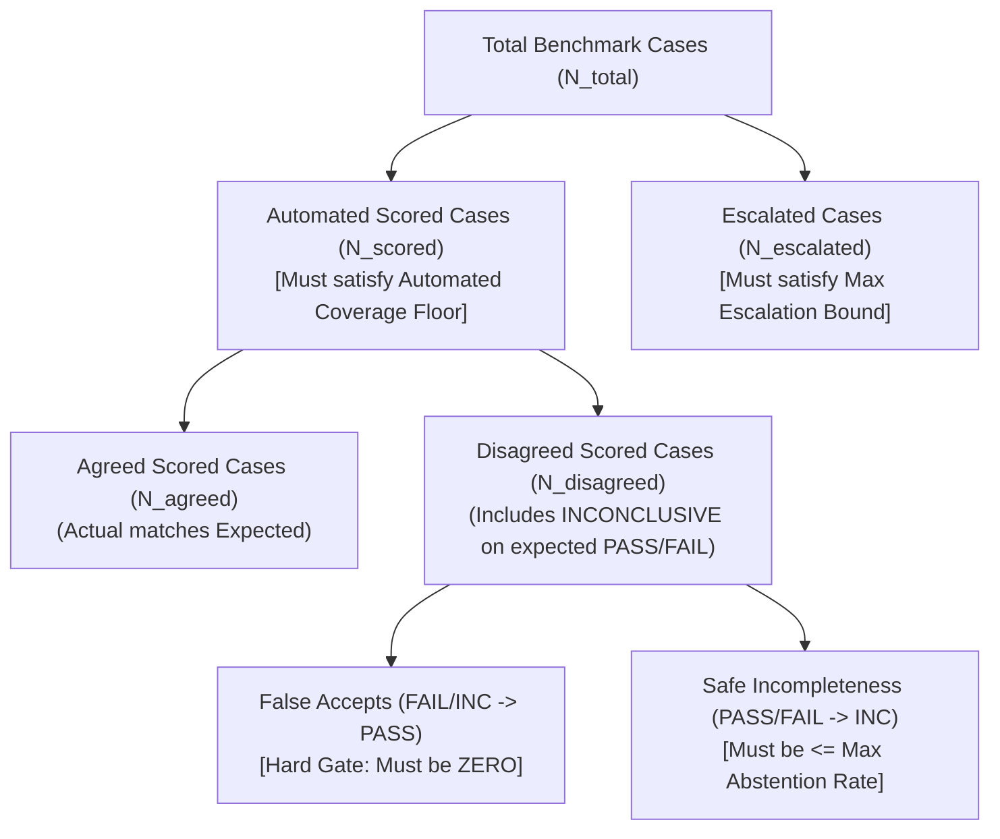

# VerifyCI — Versioned Acceptance-Policy Specification v2.0

**Document Version**: 2.0.0-PROPOSED-REVISED  
**Effective Date**: 2026-10-18  
**Policy Status**: **APPROVED IN PRINCIPLE — PENDING FORMAL FREEZE**  
**Governing Branch**: `refactor/kernel-redesign`  
**Target Reference Commit**: `75864fc575fe027ff24ccd7dac44a99d275e6fdb`  

---

## 1. Architectural Intent & Scope

This specification establishes the **Three-Pillar Acceptance Model** for VerifyCI. It defines the formal criteria under which verification capabilities, core contracts, and neuro-symbolic extensions are evaluated and accepted.

### 1.1 Governance Principles
1. **Soundness as Hard Gate**: A verification system that falsely certifies defective, tampered, or ungrounded code is catastrophic. Zero observed false acceptances on independently labeled cases is an absolute non-negotiable barrier.
2. **Observed vs Proven Invariance**: The absence of false acceptances across frozen benchmark suites is an **observed empirical result** on the evaluated cases, not mathematical proof that false acceptance is impossible across arbitrary unconstrained inputs.
3. **Sound Incompleteness vs Disagreement**: A fail-closed `INCONCLUSIVE` verdict is often the correct security decision when behavioral equivalence cannot be established. However, when an existing benchmark declares an expected verdict of `PASS` or `FAIL`, an abstention constitutes a measured divergence that must be counted as a disagreement in the denominator and bounded.
4. **No Artificial Metric Tuning**: Benchmarks, ground-truth labels, and frozen test corpora are immutable. Missing or difficult capabilities must never be papered over by rewriting labels, silently dropping difficult test cases, or broadening SMT theories unsoundly.

---

## 2. Precise Metric Definitions & Mathematical Formulation

To prevent ambiguity between decided cases, abstentions, and escalations, Policy v2 defines the verification metrics with exact mathematical formulas:

### 2.1 The Case Denominators
- **$N_{\text{total}}$**: The total number of cases contained in the frozen corpus file.
- **$N_{\text{escalated}}$**: Cases formally declared outside the scope of automated decision-making (e.g. non-code documentation files, or explicit human-review escalations). Every escalated case must be listed with its rationale and must produce a non-pass verdict (`INCONCLUSIVE` or `FAIL`).
- **$N_{\text{scored}}$**: The automated scoring denominator:
  $$N_{\text{scored}} = N_{\text{total}} - N_{\text{escalated}}$$

### 2.2 Coverage and Escalation Formulas
- **Automated Coverage ($\kappa_{\text{auto}}$)**:
  $$\kappa_{\text{auto}} = \frac{N_{\text{scored}}}{N_{\text{total}}}$$
- **Human-Review Escalation Rate ($\epsilon_{\text{esc}}$)**:
  $$\epsilon_{\text{esc}} = \frac{N_{\text{escalated}}}{N_{\text{total}}}$$

### 2.3 Verdict Agreement Metric
The verdict agreement metric measures the proportion of scored cases where the engine's automated verdict matches the expected ground-truth label under the fail-closed compatibility lattice:
$$\text{Agreement} = \frac{N_{\text{agreed}}}{N_{\text{scored}}}$$

**Crucial Denominator Rule**:
- Any case where the expected status is `PASS` or `FAIL`, but the engine yields `INCONCLUSIVE`, is **strictly counted as a disagreement** ($N_{\text{disagreed}}$) in the denominator $N_{\text{scored}}$.
- An abstention is never credited as an agreement on an expected `PASS` case.

### 2.4 Safe Abstention Rate Metric
The safe abstention rate is tracked and reported as a separate, distinct measure:
$$\text{Abstention Rate } (\alpha) = \frac{N_{\text{inconclusive}}}{N_{\text{scored}}}$$
where $N_{\text{inconclusive}}$ is the total number of scored cases yielding `INCONCLUSIVE`.

---

## 3. The Three-Pillar Acceptance Model

Every VerifyCI capability must simultaneously satisfy three independent requirements:

### Pillar 1: Security Soundness (Hard Barrier)
- **Criterion**: Zero observed false acceptances ($\text{False Accepts} = 0$) across all frozen test cases and adversarial variants.
- **Rule**: Any case labeled `FAIL` or `INCONCLUSIVE` that produces an automated `PASS` constitutes an immediate, blocking gate failure.

### Pillar 2: Verified Agreement & Coverage
- **Criterion**: Agreement must meet the predeclared agreement floor ($\text{Agreement} \ge \tau_{\text{agree}}$), and automated coverage must meet the coverage floor ($\kappa_{\text{auto}} \ge \kappa_{\text{min}}$).
- **Rule**: Denominators must be documented and immutable. Capabilities cannot meet agreement targets by routing difficult cases into human review.

### Pillar 3: Bounded Safe Abstention & Escalation
- **Criterion**: Safe abstentions must remain bounded ($\alpha \le \alpha_{\text{max}}$), and human-review escalations must remain bounded ($\epsilon_{\text{esc}} \le \epsilon_{\text{max}}$).
- **Rule**: All abstentions must deterministically emit explicit, machine-readable rule codes (`VC2-Z3-UNDECIDED-DIFF`, `VC2-NO-DEFINABLE-SCOPE`, `VC2-Z3-UNSUPPORTED-AST`). Required security checks must never fall through to silent passes.

---

## 4. Frozen Numerical Criteria for Adjusted Capabilities

The numerical bounds for `cap005` and `cap002_heldout` are explicitly frozen as follows:

| Capability Gate | Total Cases ($N_{\text{total}}$) | Minimum Coverage Floor ($\kappa_{\text{min}}$) | Maximum Escalation Bound ($\epsilon_{\text{max}}$) | Minimum Agreement Floor ($\tau_{\text{agree}}$) | Maximum Safe Abstention ($\alpha_{\text{max}}$) | Security Soundness Requirement | Measured at `75864fc` | Evaluation Under Policy v2 |
| :--- | :--- | :--- | :--- | :--- | :--- | :--- | :--- | :--- |
| **`cap005`** (Real-World Patches) | 64 | **$\ge 90.0\%$** | **$\le 10.0\%$** | **$\ge 80.0\%$** | **$\le 20.0\%$** | **Zero observed false accepts** | $\kappa = 92.19\%$ (59/64) $\epsilon = 7.81\%$ (5/64) $\text{Agreement} = 83.05\%$ (49/59) $\alpha = 16.95\%$ (10/59) $\text{False Accepts} = 0$ | **MEETS PROPOSED GATES** |
| **`cap002_heldout`** (Held-Out Patches) | 17 | **$\ge 55.0\%$** | **$\le 45.0\%$** | **$\ge 80.0\%$** | **$\le 20.0\%$** | **Zero observed false accepts** | $\kappa = 58.82\%$ (10/17) $\epsilon = 41.18\%$ (7/17) $\text{Agreement} = 80.00\%$ (8/10) $\alpha = 20.00\%$ (2/10) $\text{False Accepts} = 0$ | **AT PROPOSED BOUNDARIES** |

---

## 5. Performance Latency Percentile Standard

To eliminate ambiguity between median (p50) and tail (p95) latency requirements, the performance criteria are frozen as:

1. **Core Import Latency**: $\text{p95} < 40\text{ ms}$ (fresh Python subprocess importing `verifyci.core`).
2. **Warm Kernel Verification Latency**: $\text{p95} < 20\text{ ms}$ (in-process verification of unified diff entries).
3. **Cold CLI Invocation Latency**:
   - **Median Target**: $\text{p50} < 150\text{ ms}$ across 25 fresh CLI subprocess invocations.
   - **Tail Upper Bound**: $\text{p95} \le 175\text{ ms}$ on Windows (accounting for OS `CreateProcessW` overhead) and $\text{p95} \le 150\text{ ms}$ on Linux/POSIX.

---

## 6. Case Accounting & Escalation Taxonomy

### 6.1 `cap005` (Real-World Patches)
- **Scored Denominator**: 59 cases ($N_{\text{total}} = 64, N_{\text{escalated}} = 5$).
- **Agreed**: 49 cases (83.05%).
- **Observed False Accepts**: 0 cases.
- **Safe Abstentions (10 cases, 16.95%)**:
  1. `REAL-SEC-04` $\to$ `VC2-NO-DEFINABLE-SCOPE` (Base fixture absent; partial hunk lacks enclosing `def`).
  2. `REAL-FEAT-01` $\to$ `VC2-Z3-UNSUPPORTED-AST` (List comprehension AST outside linear integer theory).
  3. `REAL-CMP-03` $\to$ `VC2-Z3-UNSUPPORTED-AST` (Custom exception class instantiation).
  4. 7 complex feature/composite refactors $\to$ `VC2-Z3-UNDECIDED-DIFF` (`REAL-FEAT-03`, `REAL-FEAT-04`, `REAL-FEAT-06`, `REAL-FEAT-08`, `REAL-CMP-01`, `REAL-CMP-06`, `REAL-CMP-08`: dictionary transforms, string formatters, and variadic arguments outside quantifier-free LIA fragment).
- **Escalated Non-Code Documentation Cases (5 cases, 7.81%)**:
  `REAL-DOC-01`, `REAL-DOC-02`, `REAL-DOC-05`, `REAL-DOC-06`, `REAL-DOC-08` (Documentation and markdown files without code semantics; routed to review by default policy).

### 6.2 `cap002_heldout` (Held-Out Patches)
- **Scored Denominator**: 10 cases ($N_{\text{total}} = 17, N_{\text{escalated}} = 7$).
- **Agreed**: 8 cases (80.00%): `N-C1`, `N-C2`, `N-C5`, `N-C6`, `N-C7`, `N-W1`, `N-W2`, `N-W3`.
- **Observed False Accepts**: 0 cases.
- **Safe Abstentions (2 cases, 20.00%)**:
  1. `N-C4` $\to$ `VC2-Z3-UNDECIDED-DIFF` (Adds unmodeled `send_email("z")`; side-effecting callee fails closed).
  2. `N-W4` $\to$ `VC2-Z3-UNDECIDED-DIFF` (Replaces unmodeled `launch_missiles()` with `return x * 2`; unmodeled callee fails closed).
- **Separately Documented Escalations (7 cases, 41.18%)**:
  `N-C3`, `N-S1`, `N-S2`, `N-S3`, `N-S4`, `N-S5`, `N-S6`.
  In v1, these were scored under an ambiguous "human review" triage heuristic that was credited as a decline. In v2, they are formally categorized as **human review escalations**, all yielding non-pass verdicts (`INCONCLUSIVE` or `FAIL`) with **0 observed false accepts**.

---

## 7. Conditions for Final Acceptance

1. **Policy Review & Approval**: Obtain explicit maintainer sign-off on the numerical thresholds in Section 4 and Section 5.
2. **Policy Hash Freeze**: Compute and freeze the SHA-256 digest of this specification document before the final acceptance run.
3. **Clean-Room Verification**: Recompute the complete scorecard against a clean checkout, verifying that test execution, performance, security soundness, coverage, and bounded safe abstention all pass under the frozen policy.
4. **Current Status**: Maintained as **`CONDITIONAL — NOT YET ESTABLISHED`** until the final audit passes under the frozen specification.
